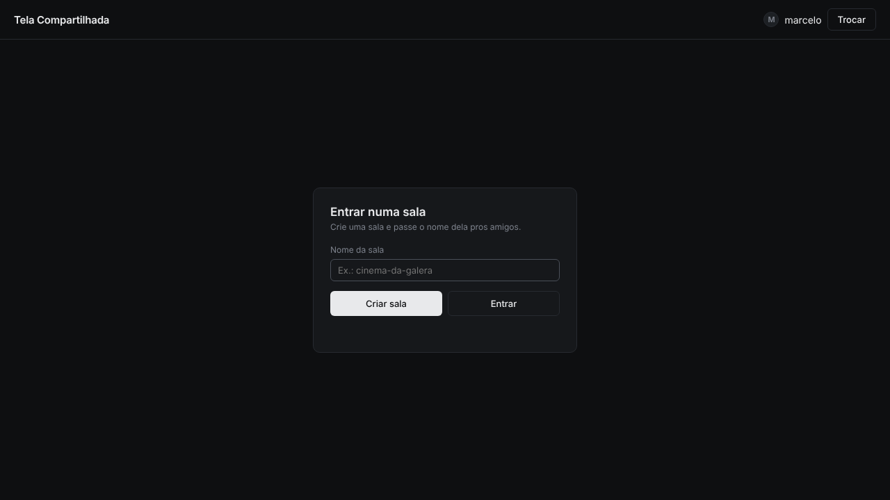

<div align="center">


# Tela Compartilhada

**Compartilhe sua tela com os amigos.**

Crie uma sala, chame a galera e transmita qualquer janela do seu PC, com som.

<br>

<a href="../../releases/latest/download/TelaCompartilhada-Setup.exe">
  
</a>

<sub>Instala em segundos e cria atalho na Área de Trabalho · Windows 10 (2004+) ou 11 · <a href="../../releases/latest">outras opções de download</a></sub>

<br><br>


</div>

<br>

## Como usar

| | |
|---|---|
| **1. Instale** | Abra o `TelaCompartilhada-Setup.exe`. Ele instala e já abre sozinho. Depois é só usar o atalho da Área de Trabalho. |
| **2. Escolha um nickname** | Na primeira vez que abrir. Fica salvo no seu PC. |
| **3. Crie uma sala** | Digite um nome, tipo `cinema-da-galera`, e clique em **Criar sala**. |
| **4. Chame os amigos** | Eles digitam o mesmo nome e clicam em **Entrar**. |
| **5. Compartilhe** | Clique em **Compartilhar** e escolha a janela ou a tela inteira. |

Para sair, clique em **Sair**. Se o dono sair, a sala fecha pra todo mundo.

<br>

## O que ele faz

- **Salas com nome:** é só combinar o nome da sala com os amigos.
- **Com som:** o áudio do programa compartilhado vai junto.
- **Qualquer um transmite:** todo mundo na sala pode compartilhar a própria tela.
- **Controle de volume:** cada transmissão tem mudo e volume próprios.
- **Simples:** instala em segundos e não precisa criar conta.

<br>

<p align="center">
  
</p>

<br>

## Bom saber

<details>
<summary><b>Apareceu "O Windows protegeu o computador"</b></summary>
<br>
Clique em <b>Mais informações</b> e depois em <b>Executar assim mesmo</b>. O aviso aparece porque o programa não tem assinatura digital paga.
</details>

<details>
<summary><b>Como desinstalar</b></summary>
<br>
Configurações do Windows → Aplicativos → <b>Tela Compartilhada</b> → Desinstalar.
</details>

<details>
<summary><b>Quantas pessoas cabem numa sala?</b></summary>
<br>
Funciona melhor com até 4 pessoas assistindo. A transmissão sai direto do PC de quem compartilha, então depende da internet (upload) dessa pessoa.
</details>

<details>
<summary><b>Diz que a sala já existe</b></summary>
<br>
Os nomes de sala são compartilhados entre todo mundo que usa o programa. Escolha um nome mais único.
</details>

<details>
<summary><b>O som não sai</b></summary>
<br>
Dê play no vídeo antes de compartilhar e, na janela de escolha, selecione o programa em <b>Som de</b>.
</details>

<br>

## Para desenvolvedores

```bash
npm install
npm start
```

| Pasta | O que tem |
|---|---|
| `src/` | App Electron (interface, salas via WebRTC/PeerJS) |
| `native/` | Captura de áudio (WASAPI) |
| `.github/workflows/` | Build do Windows, publica o instalador em Releases a cada push na `main` |
