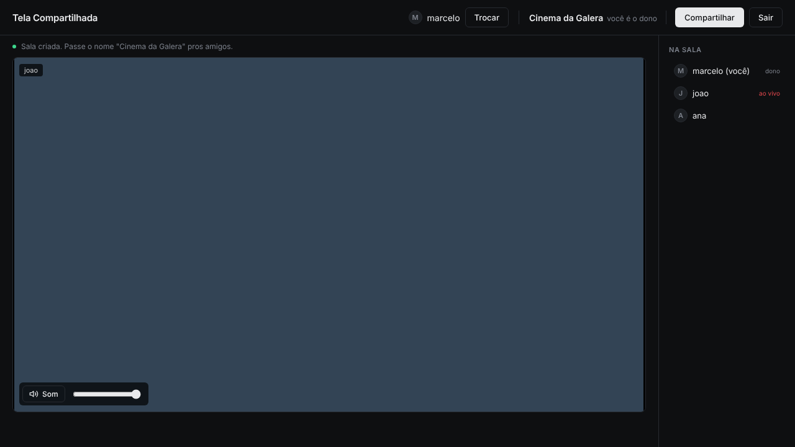

# Tela Compartilhada

Crie uma sala, chame os amigos e compartilhe a janela de um programa **com o som só dele**: o Discord fica de fora, sem eco.

### [Baixar para Windows](../../releases/latest/download/TelaCompartilhada.exe)

Não precisa instalar: é só abrir o `.exe`. Mande o mesmo arquivo pros seus amigos.



## Como usar

1. Abra o programa e escolha seu **nickname** (fica salvo).
2. Digite um nome de sala e clique em **Criar sala**.
3. Seus amigos digitam o mesmo nome e clicam em **Entrar**.
4. Clique em **Compartilhar** e escolha a janela. Só o som daquele programa vai junto.

Para sair, clique em **Sair**. Se o dono sair, a sala fecha.

## Bom saber

- Precisa de **Windows 10 (versão 2004+) ou Windows 11**.
- Se aparecer "O Windows protegeu o computador", clique em **Mais informações → Executar assim mesmo**. O aviso aparece porque o programa não tem assinatura digital.
- Funciona melhor com até **4 pessoas assistindo**: a transmissão sai direto do PC de quem compartilha.
- Não usa microfone. Conversem pelo Discord normalmente.

## Para desenvolvedores

```
npm install
npm start
```

A captura de áudio por programa fica em `native/audio-app.cpp` (WASAPI process loopback). O build do Windows roda no GitHub Actions e publica o `.exe` em Releases a cada push na `main`.
